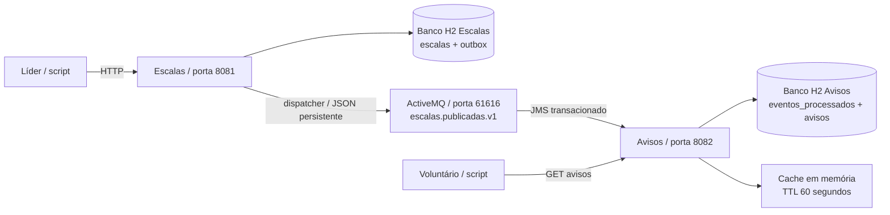

# Escalas e Avisos — projeto final

**Perfil B: sem Docker, somente Java.** Dois serviços de negócio com bancos próprios, uma fila persistente e um cache com política explícita. Tema: comunicar a publicação de escalas ministeriais aos voluntários. Prazo informado no enunciado: **23/11/2026**.

O líder cadastra uma escala e publica. O serviço Escalas grava a publicação e agenda o evento. O serviço Avisos recebe o evento pela fila e cria um aviso por voluntário. O voluntário consulta sua caixa de avisos por uma API com cache. A publicação funciona mesmo com o consumidor desligado; os avisos aparecem quando ele retorna.

Este repositório contém o projeto Java independente, inspirado no domínio de escalas ministeriais do aplicativo Igreja Escalas. Não é necessário configurar Node, Neon, Prisma ou `.env`. Os avisos são registros locais consultáveis, sem envio externo. Os voluntários são informados no cadastro da escala, sem usar dados reais.



## O que atende ao enunciado

| Exigência | Implementação e evidência |
|---|---|
| Dois serviços | JARs `escalas` e `avisos`, APIs e processos separados |
| Banco de cada serviço | `data/escalas/banco.mv.db` e `data/avisos/banco.mv.db` |
| Uma fila | ActiveMQ, destino `escalas.publicadas.v1`; produtor Escalas, consumidor Avisos |
| Mensagem repetida grava uma vez | Chave primária de `eventos_processados`, transação com os avisos e restrição única por evento/voluntário |
| Cache | Lista por voluntário, TTL 60 s, invalidação após novo aviso; `X-Cache` mostra HIT/MISS |
| ADRs | [Decisões na raiz do repositório](docs/adr/) |
| README e arquitetura | Este documento e diagrama acima |
| Extras | Outbox, retry e DLQ; testes com broker e bancos reais |

O broker é infraestrutura da fila, não um terceiro serviço de negócio. `comum` contém contrato e utilitários; `verificacao` contém somente testes.

## Testar nas telas

O painel web acompanha o JAR de Escalas. Com a compilação concluída, execute na raiz do repositório:

```powershell
powershell -ExecutionPolicy Bypass -File scripts/abrir-painel.ps1
```

O comando inicia os três processos em segundo plano e abre [o painel local](http://127.0.0.1:8081/). Eles continuam ativos para você testar. Dados e logs ficam em `data/painel/`, separados da execução manual e da demonstração automática. Repetir o comando reaproveita o ambiente já iniciado. As três portas devem estar livres na primeira abertura.

1. Clique em **Nova escala**, informe evento, data e os identificadores/nomes dos voluntários. Use, por exemplo, `ana` / `Ana` e `joao` / `João`.
2. Salve o rascunho e clique em **Publicar escala** na lista.
3. Clique em **Ver avisos** ou abra **Caixa de avisos** e consulte `ana`.
4. Consulte novamente para observar `HIT`; uma consulta nova ou invalidada mostra `MISS`.
5. Em **Escalas**, clique em **Reentregar**. O contador de duplicados aumenta após o consumo, e a quantidade de avisos permanece igual.

Os indicadores de saúde atualizam a cada cinco segundos com a página visível. As consultas de avisos são manuais para permitir comparar o cache. A lista mostra até 100 escalas, ordenadas por data do evento, e persiste ao atualizar a página. O painel adapta-se a telas pequenas; a tabela pode ser rolada horizontalmente.

Para encerrar somente os processos iniciados pelo painel, preservando os dados:

```powershell
powershell -ExecutionPolicy Bypass -File scripts/fechar-painel.ps1
```

Se usar os três terminais da execução manual, o painel também fica disponível em `http://127.0.0.1:8081/`. A interface é HTML/CSS/JavaScript estático, sem precisar de Node. O navegador consulta as duas APIs; a comunicação de negócio entre os serviços continua pela fila. Veja o [ADR do painel](docs/adr/0006-painel-local.md).

## Pré-requisitos

- JDK **21 ou superior**, com `java` e `javac` disponíveis.
- Internet na primeira compilação, para baixar Maven e dependências.
- Portas locais **61616, 8081 e 8082** disponíveis.

Não precisa instalar Maven: o wrapper incluído baixa a versão 3.9.11. Se `JAVA_HOME` estiver definido, ele deve apontar para o JDK correto. No PowerShell, ajuste para o JDK que está no PATH:

```powershell
$env:JAVA_HOME = Split-Path (Split-Path (Get-Command javac.exe).Source)
```

## Compilar e testar

Clone o repositório e entre na pasta:

```sh
git clone https://github.com/DouglasGomes32/arquitetura_software_agil.git
cd arquitetura_software_agil
```

No PowerShell, na raiz do repositório:

```powershell
.\mvnw.cmd verify
```

Linux/macOS, na mesma pasta:

```sh
sh mvnw verify
```

O comando compila, executa os testes e gera os três JARs com as dependências. Os testes não precisam dos serviços já iniciados: abrem portas aleatórias e diretórios temporários. Os relatórios ficam em `verificacao/target/surefire-reports/`.

## Executar manualmente

Abra **três terminais**, todos na raiz do repositório, e mantenha-os abertos:

```powershell
# Terminal 1 — infraestrutura da fila
java -jar broker/target/broker-1.0.0-app.jar
```

```powershell
# Terminal 2 — serviço produtor
java -jar escalas/target/escalas-1.0.0-app.jar
```

```powershell
# Terminal 3 — serviço consumidor
java -jar avisos/target/avisos-1.0.0-app.jar
```

Use `Ctrl+C` em cada terminal para encerrar. Execute sempre a partir da mesma pasta: os caminhos de dados são relativos ao diretório atual. Os arquivos H2 e KahaDB em `data/` permanecem para a próxima execução. Não abra dois processos do mesmo serviço sobre o mesmo arquivo H2.

Saúde das APIs: [Escalas](http://127.0.0.1:8081/health) e [Avisos](http://127.0.0.1:8082/health). `status: UP` indica API disponível; veja também `filaConectada` no consumidor e `outboxPendentes` no produtor. O total de pendências exibido é limitado ao lote de 50 neste exemplo.

## Demonstrar automaticamente no Windows

Com os serviços manuais encerrados, na raiz do repositório:

```powershell
powershell -ExecutionPolicy Bypass -File scripts/demonstrar.ps1
```

O script inicia os três JARs em processos separados, usa um diretório de dados novo, mostra publicação, HIT/MISS e reentrega sem duplicação, e encerra seus processos no fim. Aborta se alguma porta necessária já estiver ocupada. Os logs e o resultado ficam no diretório informado ao executar. Não altera os dados da execução manual.

## Fazer o fluxo pela API

Com os serviços iniciados manualmente, execute em um quarto PowerShell:

```powershell
$nova = @{
  evento = 'Culto de domingo'
  data = '2026-11-22'
  voluntarios = @(
    @{ id = 'ana'; nome = 'Ana' },
    @{ id = 'joao'; nome = 'João' }
  )
} | ConvertTo-Json -Depth 5
$escala = Invoke-RestMethod http://127.0.0.1:8081/escalas -Method Post -ContentType 'application/json; charset=utf-8' -Body ([Text.Encoding]::UTF8.GetBytes($nova))
Invoke-RestMethod "http://127.0.0.1:8081/escalas/$($escala.id)/publicar" -Method Post
Start-Sleep -Seconds 2
$resposta = Invoke-WebRequest 'http://127.0.0.1:8082/avisos?voluntarioId=ana' -UseBasicParsing
$resposta.Headers['X-Cache']
$resposta.Content
# A próxima consulta deve indicar HIT.
(Invoke-WebRequest 'http://127.0.0.1:8082/avisos?voluntarioId=ana' -UseBasicParsing).Headers['X-Cache']
# Reentrega física do evento original, mantendo eventoId.
Invoke-RestMethod "http://127.0.0.1:8081/escalas/$($escala.id)/reentregar" -Method Post
Start-Sleep -Seconds 2
Invoke-RestMethod 'http://127.0.0.1:8082/avisos?voluntarioId=ana'
Invoke-RestMethod http://127.0.0.1:8082/health
```

O fluxo é assíncrono: o POST retorna **202**, e os avisos chegam depois. O script automático aguarda condições com prazo, em vez de depender da pausa de dois segundos do exemplo manual. A reentrega não aumenta o número de avisos da escala; `duplicadosIgnorados` aumenta.

Para provar a invalidação, consulte Ana antes de publicar outra escala para ela. A primeira consulta após o novo evento ser processado será `MISS`, com a lista atualizada. Para provar o TTL, faça uma consulta, aguarde 60 segundos sem nova publicação e consulte de novo: será `MISS`. HIT não estende o prazo.

## Endpoints

| Serviço | Método e caminho | Resultado |
|---|---|---|
| Escalas | `POST /escalas` | 201, cria rascunho; evento, data ISO e 1–100 voluntários sem repetição |
| Escalas | `GET /escalas` | 200, até 100 escalas ordenadas por data do evento decrescente |
| Escalas | `GET /` ou `GET /painel` | Painel web para cadastro, publicação, reentrega e consulta de avisos |
| Escalas | `GET /escalas/{id}` | 200 ou 404 |
| Escalas | `POST /escalas/{id}/publicar` | 202, publica uma vez e agenda na outbox; repetir preserva eventoId |
| Escalas | `POST /escalas/{id}/reentregar` | 202, reenvia o evento original; 409 se não publicado/inexistente |
| Avisos | `GET /avisos?voluntarioId=ana` | 200, lista; cabeçalho X-Cache; 400 sem identificador |
| Ambos | `GET /health` | 200, estado e métricas locais |

Corpos inválidos retornam 400; corpos acima de 64 KiB também são rejeitados. Uma escala só possui rascunho e publicação: edição, cancelamento e nova versão ficam fora deste recorte.

## Mensagem da fila

```json
{
  "versao": 1,
  "tipo": "EscalaPublicada",
  "eventoId": "045d8dba-f86a-4cd9-9c84-c21045f16bb0",
  "escalaId": "b2b558de-d4a3-4ced-b706-aa285aa2e003",
  "ocorridoEm": "2026-11-13T15:00:00Z",
  "evento": "Culto de domingo",
  "data": "2026-11-22",
  "voluntarios": [{ "id": "ana", "nome": "Ana" }]
}
```

`eventoId` identifica a ocorrência e é a chave de idempotência. O envio JMS pode acontecer várias vezes; o efeito persistido ocorre uma vez. O commit no consumidor precede o ACK. Falha depois do commit e antes do ACK causa reentrega, que a chave única reconhece.

## Cache e tolerância a falhas

- Cache: lista de avisos por `voluntarioId`, incluindo resultado vazio; TTL fixo de **60 segundos**, máximo de 1.000 entradas, remoção da menos recentemente consultada quando cheio.
- Invalidação: após commit dos avisos de evento novo, remove somente os voluntários envolvidos. Reiniciar o consumidor esvazia todo o cache.
- Broker desligado: publicação e outbox ficam no H2; o dispatcher tenta novamente a cada 500 ms após a tentativa anterior terminar.
- Consumidor desligado: broker guarda mensagens persistentes em `data/broker/`.
- Falha no consumidor: rollback JMS, três reentregas com intervalo de 250 ms, depois `ActiveMQ.DLQ`.
- Banco do consumidor: marcador e avisos na mesma transação; falha parcial reverte tudo.

Os parâmetros podem ser passados **antes de `-jar`**: `-Dhttp.port=8092`, `-Dbroker.url=tcp://127.0.0.1:61616`, `-Descalas.db=data/escalas/banco`, `-Davisos.db=data/avisos/banco`, `-Dcache.ttl.seconds=60`, `-Dbroker.port=61616`, `-Dbroker.data=data/broker`. Cada opção só se aplica ao processo correspondente.

## Decisões, banca e entrega

Leia os [ADRs](docs/adr/) e o [roteiro de até 10 minutos](docs/apresentacao.md). A [matriz de verificação](docs/verificacao.md) relaciona requisitos e testes. Há um [plano de commits](docs/plano-de-entrega.md), sem inventar histórico retroativo.

Os módulos Java, o painel e os scripts estão na raiz; as decisões ficam em `docs/adr/`. Para gerar um ZIP com código, ADRs e documentação, execute `powershell -ExecutionPolicy Bypass -File scripts/empacotar.ps1` na raiz do repositório. Não inclui `.env`, banco, dependências baixadas ou JARs; o avaliador compila pelo wrapper.

Limitações: uso local em uma igreja, sem autenticação, sem email/WhatsApp, sem múltiplas réplicas e sem reprocessamento automático da DLQ. O enunciado aceita perfil B; a stack utilizada nas aulas não foi fornecida, então a implementação escolhe Java/JMS para demonstrar os requisitos descritos.

**Uso de IA:** este código e seus documentos foram elaborados com assistência de IA. Os testes automatizados e a demonstração devem ser executados antes da entrega. O aluno precisa ler o código, conferir o comportamento e explicar as decisões com suas próprias palavras; não declare como revisão manual algo que ainda não fez.
